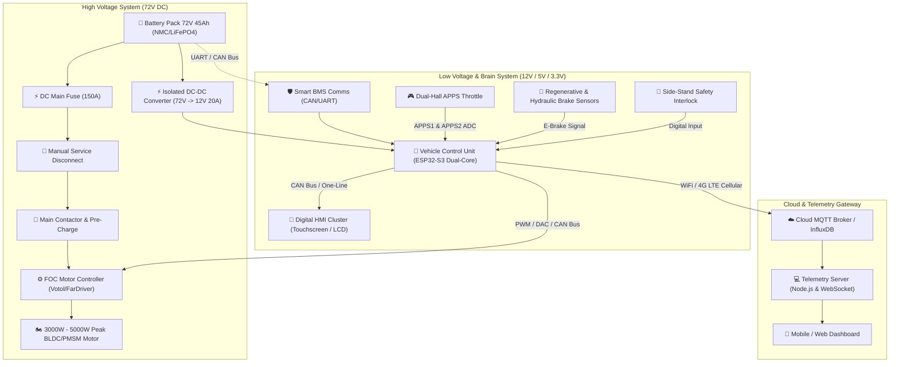

# ⚡ Laksanasoft-EV: Platform Sepeda Motor Listrik Modular & Cerdas

[](https://www.espressif.com/)
[]()
[](LICENSE)
[]()

**Laksanasoft-EV** adalah rancang bangun ekosistem terbuka (*open-architecture*) untuk konversi dan manufaktur sepeda motor listrik berperforma tinggi, aman, dan terintegrasi dengan Internet of Things (IoT). Platform ini mencakup Vehicle Control Unit (VCU) berbasis FreeRTOS, integrasi Field Oriented Control (FOC) Inverter, Battery Management System (BMS) pintar, instrumentasi digital (HMI), serta backend telemetri *real-time*.

---

## 📌 Daftar Isi
1. [Gambaran Arsitektur Sistem](#-gambaran-arsitektur-sistem)
2. [Spesifikasi Utama Kendaraan](#-spesifikasi-utama-kendaraan)
3. [Fitur Unggulan](#-fitur-unggulan)
4. [Struktur Repositori](#-struktur-repositori)
5. [Dokumentasi Lengkap](#-dokumentasi-lengkap)
6. [Panduan Memulai Cepat (Quick Start)](#-panduan-memulai-cepat-quick-start)
7. [Protokol Keamanan](#-protokol-keamanan)
8. [Lisensi & Kontribusi](#-lisensi--kontribusi)

---

## 🏛️ Gambaran Arsitektur Sistem

Ekosistem Laksanasoft-EV memisahkan jalur daya tegangan tinggi (*High Voltage Traction Loop* 72V) dengan jalur kendali tegangan rendah (*Low Voltage Signal Loop* 12V & 3.3V/5V) demi memenuhi standar keselamatan otomotif.



---

## ⚡ Spesifikasi Utama Kendaraan

| Parameter | Spesifikasi | Keterangan |
| :--- | :--- | :--- |
| **Tipe Motor** | BLDC / PMSM Mid-Drive atau Hub Motor | 3000W Nominal, 6000W Peak |
| **Tegangan Operasional** | 72V DC (Nominal) | Range: 60.0V – 84.0V |
| **Kapasitas Baterai** | 72V 45Ah (3.24 kWh) | 20S LiFePO4 / NMC Grade A |
| **Inverter / Controller** | FOC Sine-Wave Controller | 150A Phase Current, Votol EM150-2 / Kelly |
| **Vehicle Control Unit (VCU)** | ESP32-S3 Dual-Core Xtensa @ 240MHz | FreeRTOS, 8MB PSRAM, 16MB Flash |
| **Mode Berkendara** | ECO, URBAN, SPORT, REVERSE | Kurva akselerasi adaptif via software |
| **Pengereman Regeneratif** | Elektronik Proporsional (E-Braking) | Mengembalikan energi hingga 12% ke baterai |
| **Kecepatan Maksimal** | 85 - 95 km/jam | Tergantung gear ratio dan profil pengendara |
| **Jarak Tempuh (Est.)** | 90 - 110 km | Mode ECO pada kecepatan rata-rata 40 km/jam |
| **Waktu Pengisian** | 2.5 Jam (Fast 15A) / 5 Jam (Standard 8A) | CC/CV Smart Charger dengan Auto-Cutoff |

---

## ✨ Fitur Unggulan

1. **Dual-Channel Throttle Plausibility (APPS):**
   Mendeteksi perbedaan sinyal akselerator (*throttle mismatch*) untuk mencegah motor melaju sendiri jika terjadi kabel putus atau korsleting (*anti-runaway safety*).
2. **Sistem Pre-Charge Terintegrasi:**
   Mencegah lonjakan arus awal (*inrush current*) dan percikan busur api (*sparking*) pada kapasitor inverter saat kunci kontak dinyalakan.
3. **Brake Over Accelerator (BOA) Priority:**
   Secara instan memutus output daya ke motor saat tuas rem terdeteksi ditekan.
4. **Thermal Throttling Adaptif:**
   Mengurangi suplai arus secara bertahap jika suhu motor atau inverter melebihi ambang batas (75°C - 90°C) sebelum mencapai pemutusan darurat.
5. **Telemetri Real-Time & HMI Modern:**
   Streaming data sensor (kecepatan, tegangan per sel, arus ampere, konsumsi watt-jam/km, estimasi sisa jarak) via CAN Bus, WebSocket, dan MQTT.

---

## 📂 Struktur Repositori

```text
laksanasoft-ev/
├── docs/                           # Dokumentasi teknis komprehensif
│   ├── 01-spesifikasi-sistem.md    # Detail spesifikasi teknis dan mekanikal
│   ├── 02-bill-of-materials-bom.md # Daftar alat, bahan, dan estimasi biaya
│   ├── 03-skematik-dan-wiring-diagram.md # Diagram pengkabelan HV & LV
│   ├── 04-alur-dan-cara-kerja.md   # State machine, alur start-up & algoritma
│   ├── 05-protokol-keamanan-failsafe.md  # Standar keselamatan & penanganan fault
│   └── 06-telemetri-dan-iot.md     # Spesifikasi frame CAN & MQTT payload
├── firmware/                       # Source code Vehicle Control Unit (VCU)
│   └── vcu/
│       ├── include/                # Header files & konfigurasi pinout
│       ├── src/                    # State machine, APPS handler, BMS driver, CAN
│       └── platformio.ini          # Konfigurasi build PlatformIO
├── telemetry-server/               # Backend telemetri IoT (Node.js & WebSocket)
│   ├── package.json
│   └── server.js
├── dashboard-ui/                   # Instrument cluster digital (Web/HMI)
│   ├── index.html
│   ├── styles.css
│   └── app.js
├── simulator/                      # Software-In-The-Loop (SITL) EV Simulator
│   ├── requirements.txt
│   └── vehicle_simulator.py
├── LICENSE                         # Lisensi proyek (MIT)
└── README.md                       # Dokumentasi utama proyek
```

---

## 📚 Dokumentasi Lengkap

Untuk panduan mendalam langkah demi langkah, silakan pelajari dokumen pada folder [`docs/`](docs/):
- 📘 [Spesifikasi Teknis & Kalkulasi Daya](docs/01-spesifikasi-sistem.md)
- 🛒 [Daftar Alat & Bahan (BOM Lengkap)](docs/02-bill-of-materials-bom.md)
- 🔌 [Skematik & Wiring Diagram Lengkap](docs/03-skematik-dan-wiring-diagram.md)
- 🔄 [Alur Logika & Cara Kerja Sistem](docs/04-alur-dan-cara-kerja.md)
- 🛡️ [Protokol Keamanan & Interlock Failsafe](docs/05-protokol-keamanan-failsafe.md)
- 📡 [Protokol Komunikasi CAN Bus & Telemetri MQTT](docs/06-telemetri-dan-iot.md)

---

## 🚀 Panduan Memulai Cepat (Quick Start)

### 1. Menjalankan Simulator Kendaraan & Backend
Anda dapat menguji seluruh sistem dan dasbor digital tanpa perangkat keras fisik menggunakan simulator python bawaan:

```bash
# 1. Jalankan Backend Telemetri
cd telemetry-server
npm install
npm start

# 2. Jalankan Simulator Kendaraan (Terminal Baru)
cd ../simulator
python3 -m venv venv && source venv/bin/activate
pip install -r requirements.txt
python vehicle_simulator.py

# 3. Buka Dashboard HMI
# Buka file dashboard-ui/index.html di browser web Anda
```

### 2. Kompilasi Firmware VCU
Pastikan [PlatformIO Core](https://platformio.org/) atau VS Code Extension sudah terpasang:

```bash
cd firmware/vcu
pio run --target upload
```

---

## 🛡️ Protokol Keamanan

> [!WARNING]
> Sistem daya kendaraan ini menggunakan tegangan tinggi DC (72V DC nominal, hingga 84V DC puncak). Arus hubung singkat baterai litium dapat mencapai lebih dari 500 Ampere. Selalu gunakan sarung tangan berisolasi kelas 0 (1000V), kacamata pelindung, dan pastikan Manual Service Disconnect (MSD) dilepas saat melakukan perakitan atau perawatan kelistrikan.

---

## 📄 Lisensi

Proyek ini dilisensikan di bawah **MIT License**. Lihat file [LICENSE](LICENSE) untuk rincian lengkap.

Dikembangkan dengan dedikasi untuk kemajuan teknologi transportasi elektrifikasi Indonesia oleh **PT. Laksana Digital Industri**.
