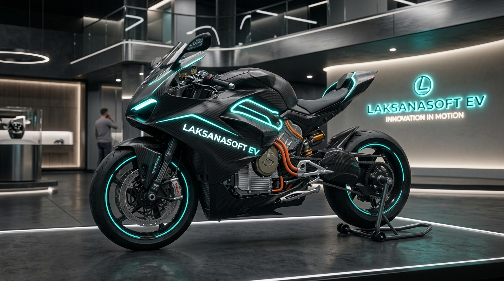
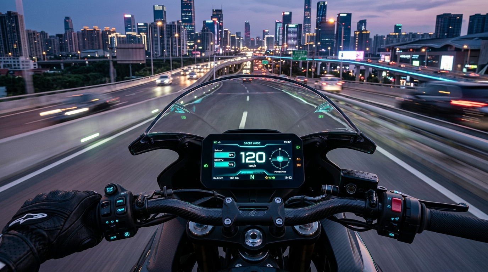

# ⚡ Laksanasoft-EV: Platform Sepeda Motor Listrik Cerdas & Modular (Smart ADAS 120 km/h)

[](https://www.espressif.com/)
[]()
[](LICENSE)
[]()

<div align="center">
  
  <p><em>Konsep Desain Laksanasoft-EV — Smart Cyber-Aerodynamic Electric Motorcycle (120 km/jam, 18kW Peak Powertrain)</em></p>
</div>

---

**Laksanasoft-EV** adalah rancang bangun ekosistem terbuka (*open-architecture*) untuk konversi dan manufaktur sepeda motor listrik pintar berperforma tinggi. Platform ini mengintegrasikan teknologi **Smart VCU 2.0**, sensor inersia **6-Axis IMU (Lean Angle Detection)**, **Traction Control System (TCS)**, sistem akses **Smart Keyless (NFC & BLE Proximity)**, arsitektur **Dual-Battery Active Balancing (72V Hot-Swappable)**, serta kemampuan jelajah hingga kecepatan puncak **120 – 125 km/jam**.

---

<div align="center">
  
  <p><em>Cockpit Digital Instrument Cluster HMI 7-Inci — Real-time 120 km/h Telemetry, Lean Angle & Dual-Battery BMS</em></p>
</div>

---

## 📌 Daftar Isi
1. [Fitur Unggulan Sistem Cerdas](#-fitur-unggulan-sistem-cerdas)
2. [Spesifikasi Utama Kendaraan](#-spesifikasi-utama-kendaraan)
3. [Alat & Bahan yang Mudah Dijangkau](#-alat--bahan-yang-mudah-dijangkau-pasar-indonesia)
4. [Master Wiring Diagram](#-master-wiring-diagram)
5. [Struktur Repositori](#-struktur-repositori)
6. [Dokumentasi Lengkap](#-dokumentasi-lengkap)
7. [Panduan Memulai Cepat (Quick Start)](#-panduan-memulai-cepat-quick-start)
8. [Lisensi](#-lisensi)

---

## 🧠 Fitur Unggulan Sistem Cerdas

1. **6-Axis IMU & Lean Angle Safety:**
   - Membaca sudut kemiringan rebah motor saat menikung (*cornering lean angle*).
   - Membatasi hentakan torsi akselerasi secara adaptif saat motor miring di atas $35^\circ$ demi mencegah ban selip (*low-side accident*).
   - *Tip-Over Crash Cutoff:* Memutus arus utama seketika jika motor terjatuh $\ge 60^\circ$ dan mengirim sinyal darurat SOS via telemetri IoT.
2. **Traction Control System (TCS):**
   - Mendeteksi selisih putaran roda belakang terhadap kecepatan aktual (*wheel slip*).
   - Mengurangi torsi hingga $40\%$ dalam waktu $< 15\text{ ms}$ untuk menjaga stabilitas di jalan basah/berpasir.
3. **Smart Keyless Access (NFC & BLE Proximity):**
   - *Passive Keyless Entry:* Otomatis membuka kunci (*Unlock*) saat pengendara mendekat $\le 1.5\text{ m}$ dan mengunci otomatis saat menjauh.
   - Mendukung tap kartu NFC / e-KTP dan kode PIN darurat pada layar HMI.
4. **Dual-Battery Modular Architecture (72V 60Ah / 4.3 kWh):**
   - Mendukung 2 unit baterai portabel *hot-swappable* yang dapat dicopot untuk di-charge di rumah.
   - Dilengkapi *Smart Ideal Diode Controller* untuk mencegah arus saling mengisi antar baterai (*cross-charging*).
5. **High-Performance 120 km/jam Powertrain:**
   - Motor Mid-Drive QS 138 90H V3 ($18\text{ kW}$ Peak) + Inverter FOC dengan **Active Flux Weakening** hingga 6200 RPM.

---

## ⚡ Spesifikasi Utama Kendaraan

| Parameter | Spesifikasi Smart High-Performance (120 km/jam) |
| :--- | :--- |
| **Kecepatan Maksimal** | **120 – 125 km/jam** (Active Flux Weakening) |
| **Akselerasi (0 - 100 km/jam)**| **< 5.2 Detik** |
| **Tipe Motor Traksi** | **QS Motor 138 90H V3 Mid-Drive** ($18\text{ kW}$ Peak, Torsi 72 Nm) |
| **Rasio Reduksi Gir** | **1 : 3.0** (Sprocket 15T : 45T Rantai Heavy Duty 428H) |
| **Inverter / Controller** | **FarDriver ND72680** atau **Votol EM-200-2 / EM-260** (200A Bus / 680A Phase) |
| **Sistem Baterai** | **Dual Pack 72V 30Ah + 30Ah (Total 60Ah / 4.32 kWh)** Li-Ion/NMC Grade A |
| **Smart BMS** | **Dual Smart BMS 20S 200A Peak** + Active Balancer 2A |
| **Komputasi & ADAS** | **ESP32-S3 Smart VCU 2.0 + 6-Axis IMU + TCS + BLE/NFC Keyless** |
| **Proteksi Arus Tinggi (HV)**| **MCB DC 2-Pole 150A – 200A** + XT90-S Anti-Spark |
| **Kabel Daya Utama** | **Kabel Silikon Tahan Panas 200°C AWG 4 / AWG 2 (25 – 35 mm²)** |
| **Sistem Pengereman** | **Double Disc 4-Piston Depan + Adaptive High-Speed Regenerative Braking** |
| **Estimasi Jarak Tempuh** | **90 – 120 km** (Mode ECO/URBAN) / **65 – 80 km** (High-Speed Cruising) |

---

## 🛒 Alat & Bahan yang Mudah Dijangkau (Pasar Indonesia)

Semua komponen dirancang agar mudah dibeli di **Tokopedia, Shopee, Toko Listrik, dan Toko Variasi Motor**:
- **Motor & Inverter:** QS Motor 138 90H + FarDriver ND72680 / Votol EM-200 (kabel soket PNP).
- **Pengaman:** MCB DC 2-Pole 150A-200A (Merk Nader/Chint/FEEO - toko listrik / PLTS).
- **Smart Keyless:** Modul PN532 NFC Reader + ESP32-S3 BLE onboard.
- **Sensor IMU:** Modul MPU6050 / ICM-42688 6-DOF I2C (Rp 25.000 - Rp 45.000).
- **Stepdown 12V:** Modul DC-DC 72V ke 12V 20A Alumunium (240W).

👉 Pelajari selengkapnya di [**Panduan Belanja Lokal Indonesia**](docs/02b-panduan-belanja-lokal-indonesia.md).

---

## 📂 Struktur Repositori

```text
laksanasoft-ev/
├── docs/                                     # Dokumentasi teknis komprehensif
│   ├── assets/                               # Gambar visual render & diagram
│   │   ├── laksanasoft-ev-showcase.jpg       # Render motor Laksanasoft-EV
│   │   └── laksanasoft-ev-cockpit.jpg        # Render cockpit HMI cluster
│   ├── 01-spesifikasi-sistem.md              # Kalkulasi traksi 120 km/jam & powertrain
│   ├── 02-bill-of-materials-bom.md           # BOM part standar & upgrade 120 km/jam
│   ├── 02b-panduan-belanja-lokal-indonesia.md# Panduan belanja & link part e-commerce lokal
│   ├── 03-skematik-dan-wiring-diagram.md     # Master wiring diagram pin-to-pin
│   ├── 04-alur-dan-cara-kerja.md             # State machine, TCS & Flux Weakening
│   ├── 05-protokol-keamanan-failsafe.md      # Standar keselamatan & interlock failsafe
│   ├── 06-telemetri-dan-iot.md               # Spesifikasi frame CAN & MQTT payload
│   └── 07-sistem-cerdas-iot-dan-adas.md      # Arsitektur IMU 6-DOF, TCS, Keyless & Dual BMS
├── firmware/vcu/                             # Source code Smart VCU 2.0 (ESP32-S3)
│   ├── include/                              # Header files (IMU, TCS, Keyless, Dual BMS)
│   ├── src/                                  # Implementasi FreeRTOS Task (Core 0 & Core 1)
│   └── platformio.ini                        # Konfigurasi build PlatformIO
├── telemetry-server/                         # Backend telemetri IoT (Node.js & WebSocket)
├── dashboard-ui/                             # Smart 7" Digital Cluster HMI
└── simulator/                                # Software-In-The-Loop (SITL) Smart Simulator
```

---

## 🚀 Panduan Memulai Cepat (Quick Start)

```bash
# 1. Jalankan Backend Telemetri
cd telemetry-server
npm install && npm start

# 2. Jalankan Simulator Kendaraan Cerdas (Terminal baru)
cd ../simulator
pip install -r requirements.txt
python vehicle_simulator.py

# 3. Buka Dashboard HMI
# Buka file dashboard-ui/index.html di browser Anda
```

---

## 📄 Lisensi

Didistribusikan untuk kemajuan ekosistem kendaraan listrik cerdas Indonesia oleh **PT. Laksana Digital Industri**.

---

<p align="center">
  Dibuat dengan ❤️ oleh <b>Muhammad Fikri Dev</b>
</p>

