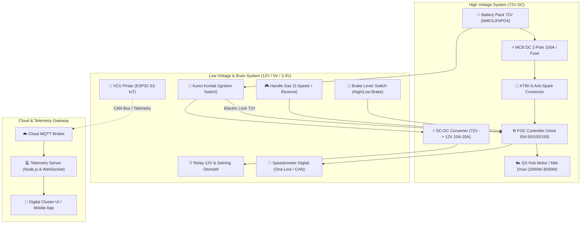

# ⚡ Laksanasoft-EV: Platform Sepeda Motor Listrik Modular & Cerdas

[](https://www.espressif.com/)
[]()
[](LICENSE)
[]()

**Laksanasoft-EV** adalah rancang bangun ekosistem terbuka (*open-architecture*) untuk konversi dan manufaktur sepeda motor listrik berperforma tinggi, aman, mudah dirakit, dan didukung alat/bahan yang **sangat mudah dijangkau di pasaran Indonesia**.

Platform ini mencakup panduan wiring diagram lengkap (pin-to-pin & kode warna), Vehicle Control Unit (VCU) berbasis FreeRTOS, integrasi Inverter FOC (Votol/FarDriver/Kelly), Battery Management System (BMS) pintar, instrumentasi digital (HMI), serta backend telemetri *real-time*.

---

## 📌 Daftar Isi
1. [Gambaran Arsitektur Sistem](#-gambaran-arsitektur-sistem)
2. [Spesifikasi Utama Kendaraan](#-spesifikasi-utama-kendaraan)
3. [Alat & Bahan yang Mudah Dijangkau](#-alat--bahan-yang-mudah-dijangkau-pasar-indonesia)
4. [Master Wiring Diagram Ringkas](#-master-wiring-diagram-ringkas)
5. [Struktur Repositori](#-struktur-repositori)
6. [Dokumentasi Lengkap](#-dokumentasi-lengkap)
7. [Panduan Memulai Cepat (Quick Start)](#-panduan-memulai-cepat-quick-start)
8. [Lisensi](#-lisensi)

---

## 🏛️ Gambaran Arsitektur Sistem

Ekosistem Laksanasoft-EV memisahkan jalur daya tegangan tinggi (*High Voltage Traction Loop* 72V) dengan jalur kendali tegangan rendah (*Low Voltage Signal Loop* 12V & 5V/3.3V) demi memenuhi standar keselamatan otomotif.



---

## ⚡ Spesifikasi Utama Kendaraan

| Parameter | Opsi Budget / Komuter | Opsi Performa Tinggi (Sport) |
| :--- | :--- | :--- |
| **Tipe Motor** | QS Hub Motor 2000W (Plug & Play Velg Matic) | QS 138 70H Mid-Drive 3000W - 6000W Peak |
| **Tegangan Operasional** | 72V DC (Nominal) | 72V DC (Nominal, 84V Puncak) |
| **Kapasitas Baterai** | 72V 30Ah (2.16 kWh) Lithium | 72V 45Ah (3.24 kWh) LiFePO4/NMC |
| **Controller Motor** | Votol EM-50S / EM-100 FOC Sine-Wave | Votol EM-150-2 / FarDriver ND72530 |
| **Proteksi HV** | MCB DC 2-Pole 63A/100A + XT90-S Anti-Spark | DC Contactor 200A + Pre-Charge Relay |
| **Kecepatan Maksimal** | 65 - 75 km/jam | 85 - 95 km/jam |
| **Estimasi Jarak Tempuh**| 60 - 75 km per charge | 90 - 110 km per charge |
| **Estimasi Total Biaya**| **± Rp 10.500.000 – Rp 14.500.000** | **± Rp 20.000.000 – Rp 25.800.000** |

---

## 🛒 Alat & Bahan yang Mudah Dijangkau (Pasar Indonesia)

Semua komponen dirancang agar mudah dibeli di **Tokopedia, Shopee, Toko Listrik, dan Toko Variasi Motor**:
- **Hub Motor & Controller:** QS Hub Motor + Votol EM-50S/EM-100 (kabel soket PNP).
- **Pengaman:** MCB DC 2-Pole 100A (Merk Nader/Chint/FEEO - biasa di toko listrik/PLTS).
- **Stepdown 12V:** Modul DC-DC 72V ke 12V 10A (banyak di toko sepeda listrik).
- **Kelistrikan 12V:** Kunci kontak Beat/Vario, Relay klakson Bosch/Denso, Sekring blade 10A/15A.
- **Kabel:** Kabel NYAF 10–16 mm² SNI atau kabel silikon AWG 8.

👉 Pelajari selengkapnya di [**Panduan Belanja Lokal Indonesia**](docs/02b-panduan-belanja-lokal-indonesia.md).

---

## 🔌 Master Wiring Diagram Ringkas

```text
[ BATERAI 72V (+) ] ---> [ MCB DC 100A ] ---> [ XT90-S ] ---> [ Controller B+ ]
[ BATERAI 72V (-) ] ---> [ BMS P- ] -------------------------> [ Controller B- ]

[ KUNCI KONTAK ] ======> Memberi daya 72V ke:
                         ├── 1. Kabel Oranye Controller (Electric Lock / Ignition)
                         └── 2. Input DC-DC Stepdown (72V ke 12V)

[ OUTPUT DC-DC 12V ] ==> [ Fuse Box 12V ] ===> Menyuplai Lampu, Sein, Klakson, & Switch Rem
```

👉 Skema lengkap pin-to-pin, kode warna kabel, dan terminal relay tersedia di [**Skematik & Wiring Diagram Lengkap**](docs/03-skematik-dan-wiring-diagram.md).

---

## 📂 Struktur Repositori

```text
laksanasoft-ev/
├── docs/                                     # Dokumentasi teknis komprehensif
│   ├── 01-spesifikasi-sistem.md              # Detail spesifikasi teknis dan kalkulasi daya
│   ├── 02-bill-of-materials-bom.md           # Bill of materials standar & alternatif budget
│   ├── 02b-panduan-belanja-lokal-indonesia.md# Panduan belanja & link part e-commerce lokal
│   ├── 03-skematik-dan-wiring-diagram.md     # Master wiring diagram, warna kabel & pinout
│   ├── 04-alur-dan-cara-kerja.md             # State machine, alur start-up & algoritma
│   ├── 05-protokol-keamanan-failsafe.md      # Standar keselamatan & penanganan fault
│   └── 06-telemetri-dan-iot.md               # Spesifikasi frame CAN & MQTT payload
├── firmware/vcu/                             # Source code Vehicle Control Unit (ESP32-S3)
│   ├── include/                              # Header files & konfigurasi pinout
│   ├── src/                                  # State machine, APPS handler, BMS driver, CAN
│   └── platformio.ini                        # Konfigurasi build PlatformIO
├── telemetry-server/                         # Backend telemetri IoT (Node.js & WebSocket)
│   ├── package.json
│   └── server.js
├── dashboard-ui/                             # Instrument cluster digital (Web/HMI)
│   ├── index.html
│   ├── styles.css
│   └── app.js
├── simulator/                                # Software-In-The-Loop (SITL) EV Simulator
│   ├── requirements.txt
│   └── vehicle_simulator.py
├── LICENSE                                   # Lisensi proyek (MIT)
└── README.md                                 # Dokumentasi utama proyek
```

---

## 🚀 Panduan Memulai Cepat (Quick Start)

### 1. Menjalankan Simulator Kendaraan & HMI Dashboard
Anda dapat menguji seluruh sistem dan dasbor digital tanpa perangkat keras fisik menggunakan simulator bawaan:

```bash
# 1. Jalankan Backend Telemetri
cd telemetry-server
npm install
npm start

# 2. Jalankan Simulator Kendaraan (Buka terminal baru)
cd ../simulator
pip install -r requirements.txt
python vehicle_simulator.py

# 3. Buka Dashboard HMI
# Buka file dashboard-ui/index.html di browser web Anda
```

### 2. Kompilasi Firmware VCU
Jika menggunakan modul pintar ESP32-S3 VCU:

```bash
cd firmware/vcu
pio run --target upload
```

---

## 📄 Lisensi

Proyek ini dilisensikan di bawah **MIT License**. Lihat file [LICENSE](LICENSE) untuk rincian lengkap.

Dikembangkan untuk kemudahan elektrifikasi kendaraan mandiri di Indonesia oleh **PT. Laksana Digital Industri**.
