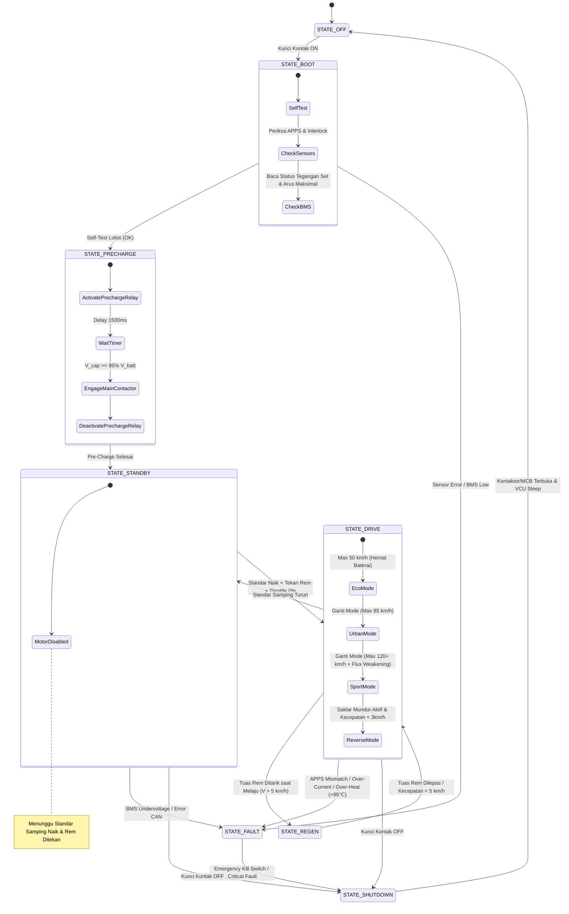

# 🔄 Alur & Cara Kerja Sistem (High Performance Edition - 120 km/jam)

Dokumen ini menjelaskan logika operasional menyeluruh, mesin status (*Finite State Machine* / FSM), algoritma pengkondisian gas, manajemen *Flux Weakening*, perhitungan pengereman regeneratif, dan manajemen termal pada platform **Laksanasoft-EV** berkecepatan **120 km/jam**.

---

## 1. Siklus Hidup Mesin Status Kendaraan (Vehicle State Machine)

VCU Laksanasoft-EV berjalan pada sistem operasi *real-time* (FreeRTOS) dengan transisi status yang terisolasi dan deterministik:



---

## 2. Algoritma Pemetaan Gas & Manajemen Kecepatan 120 km/jam

```
Torsi Target (%)
 100% |                                      / (SPORT - 120+ km/jam, Full 18kW Peak)
      |                                     /
  70% |                            _..---''   (URBAN - 85 km/jam, 8kW Peak)
      |                    _..---''
  35% |              _..-''                  (ECO - 50 km/jam, 3kW Cruise)
      |        _..-''
   0% +----------------------------------------
      0%      25%      50%      75%     100%  Bukaan Gas (APPS %)
```

### Rumus Karakteristik Mode:
1. **Mode ECO (Jelajah Jauh):**
   - Batas Daya: $35\%$ ($3000\text{W}$).
   - Batas Kecepatan: **$50\text{ km/jam}$**.
   - Konsumsi energi sangat hemat ($\approx 22\text{ Wh/km}$), memaksimalkan jarak tempuh hingga $110\text{ km}$.
2. **Mode URBAN (Harian Responsif):**
   - Batas Daya: $70\%$ ($8000\text{W}$).
   - Batas Kecepatan: **$85\text{ km/jam}$**.
   - Karakter linier untuk lalu lintas perkotaan dan jalan lingkar.
3. **Mode SPORT / BOOST (Performa Puncak 120 km/jam):**
   - Daya Puncak: **$100\%$ ($15.000\text{W} - 18.000\text{W}$ Peak)**.
   - Kecepatan Puncak: **$120 - 125\text{ km/jam}$**.
   - Algoritma **Active Flux Weakening** aktif otomatis ketika putaran motor melebihi $3500\text{ RPM}$ untuk menembus batas tegangan induksi balik (*Back-EMF*).
4. **Mode REVERSE (Mundur):**
   - Batas daya: $15\%$, kecepatan dikunci otomatis pada $5\text{ km/jam}$.

---

## 3. Logika Pengereman Regeneratif Kecepatan Tinggi (High-Speed E-Braking)

Pengereman pada kecepatan $120\text{ km/jam}$ menghasilkan energi kinetik yang sangat besar ($E_k = \frac{1}{2} m v^2 \approx 116.6\text{ kJ}$).

1. **Fase Deselerasi Awal ($120 \rightarrow 60\text{ km/jam}$):**
   - Inverter mengalirkan arus regen pengereman dinamis hingga $60\text{A}$ ke baterai, memberikan efek pengereman mesin (*engine brake*) yang kuat dan stabil tanpa mengunci roda belakang.
2. **Fase Transisi ($60 \rightarrow 10\text{ km/jam}$):**
   - Torsi pengereman regeneratif berangsur ditransisikan ke rem hidrolik fisik cakram 4-piston.
3. **Fase Berhenti ($< 5\text{ km/jam}$):**
   - Pengereman regeneratif dinonaktifkan secara halus agar motor tidak tersentak saat berhenti sempurna.

---

## 4. Manajemen Termal Kecepatan Tinggi (Thermal Throttling)

Cruising pada kecepatan $120\text{ km/jam}$ secara terus menerus memicu kenaikan suhu pada kabel fasa, MOSFET controller, dan lilitan stator motor:

| Suhu Sensor | Status Operasional | Tindakan VCU |
| :--- | :--- | :--- |
| $< 75^\circ\text{C}$ | Normal | Daya penuh $18\text{ kW}$ tersedia tanpa limitasi |
| $75^\circ\text{C} - 88^\circ\text{C}$ | Peringatan Suhu Tinggi (*Warm*) | Pembatasan daya bertahap dari 100% turun ke 65% (*Linear Derating*) |
| $88^\circ\text{C} - 95^\circ\text{C}$ | Kritis (*Over-Heat*) | Daya dikunci maksimal 30% (Kecepatan turun ke 60 km/jam demi pendinginan) |
| $> 95^\circ\text{C}$ | Bahaya Termal (*Cutoff*) | Pemutusan daya motor (*Emergency Safe Torque Off*) |
