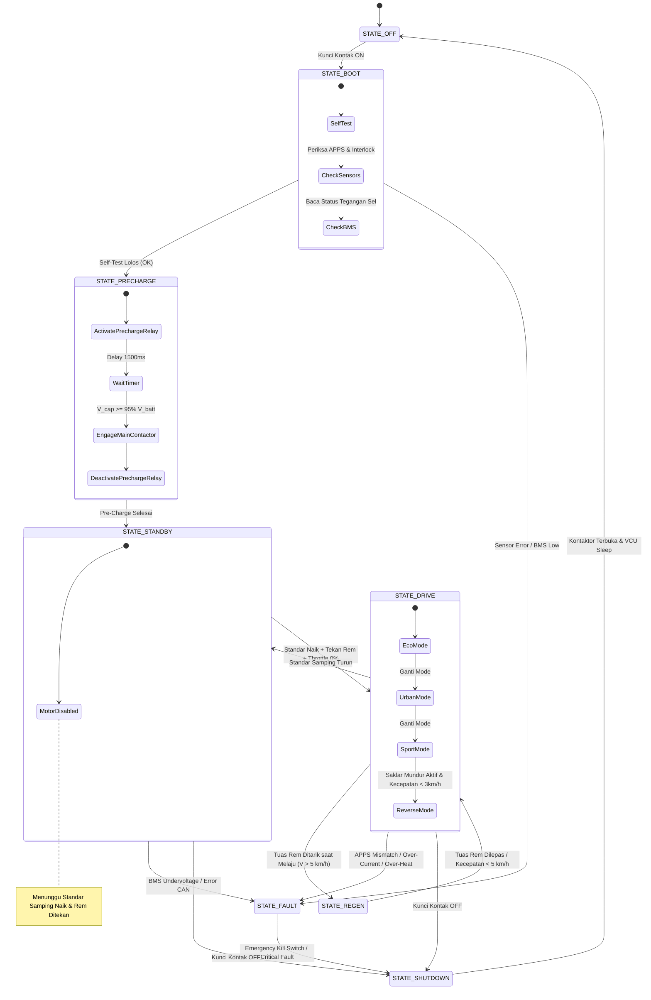

# 🔄 Alur & Cara Kerja Sistem Laksanasoft-EV

Dokumen ini menjelaskan logika operasional menyeluruh, mesin status (*Finite State Machine* / FSM), algoritma pengkondisian gas, perhitungan pengereman regeneratif, dan manajemen termal pada platform **Laksanasoft-EV**.

---

## 1. Siklus Hidup Mesin Status Kendaraan (Vehicle State Machine)

VCU Laksanasoft-EV berjalan pada sistem operasi *real-time* (FreeRTOS) dengan transisi status yang terisolasi dan deterministik:



---

## 2. Alur Kerja Detil Setiap Fase

### A. Prosedur Start-Up & Pre-Charge
1. Pengendara memutar kunci kontak ke posisi **ON**.
2. Modul DC-DC Converter menyala dan menyuplai tegangan $12\text{V}$ ke sistem kendali serta $3.3\text{V}$ ke VCU ESP32-S3.
3. VCU melakukan *Power-On Self-Test (POST)* selama $200\text{ ms}$:
   - Memvalidasi offset tegangan nol sensor APPS.
   - Membaca data status BMS via UART/CAN (memastikan semua sel berada pada rentang $3.0\text{V} - 4.2\text{V}$).
   - Memastikan tombol *Emergency Kill Switch* tidak aktif.
4. VCU mengaktifkan **Pre-Charge Relay** (Pin GPIO 9). Arus baterai mengalir melalui resistor $100\,\Omega / 50\text{W}$ ke inverter.
5. Setelah waktu tunda $1.5\text{ detik}$, kapasitor inverter terisi penuh. VCU menyalakan **Main Contactor** (Pin GPIO 8).
6. Pre-Charge Relay dimatikan. Kendaraan memasuki status **STANDBY**.

### B. Prosedur Persiapan Melaju (Arming System)
Untuk mencegah kendaraan meloncat secara tidak sengaja (*anti-lurch*), sistem hanya dapat beralih ke status **DRIVE** jika memenuhi 3 syarat wajib:
- Standar samping terlipat ke atas (*side stand retracted*).
- Tuas rem ditekan sedikit (*brake engaged*).
- Bukaan gas berada pada posisi $0\%$ (idle).
Setelah ketiga kondisi terpenuhi, lampu indikator **READY** menyala hijau pada layar HMI.

---

## 3. Algoritma Pemetaan Gas (Throttle Curve Mapping)

VCU mengonversi input sudut bukaan gas pengendara ($0\% - 100\%$) menjadi sinyal perintah torsi/arus ke inverter berdasarkan mode berkendara yang dipilih:

```
Torsi Target (%)
 100% |                                      / (SPORT - Responsif Linear Penuh)
      |                                     /
  75% |                            _..---''   (URBAN - Karakter Natural)
      |                    _..---''
  50% |              _..-''                  (ECO - Kurva S Progresif Halus)
      |        _..-''
  25% |   _.-''
      | _/
   0% +----------------------------------------
      0%      25%      50%      75%     100%  Bukaan Gas (APPS %)
```

### Rumus Karakteristik Mode:
1. **Mode ECO:**
   - Pembatasan daya maksimal: $40\%$ ($1200\text{W}$).
   - Kecepatan maksimal dibatasi pada $45\text{ km/jam}$.
   - Kurva akselerasi menggunakan pemetaan kuadratik halus:
     $$T_{out} = 0.40 \times (Throttle_{in})^2$$
2. **Mode URBAN (Normal):**
   - Pembatasan daya maksimal: $75\%$ ($2250\text{W}$).
   - Kecepatan maksimal: $70\text{ km/jam}$.
   - Karakter linier teredam:
     $$T_{out} = 0.75 \times Throttle_{in}$$
3. **Mode SPORT:**
   - Akselerasi penuh $100\%$ ($3000\text{W}$ nominal, $6000\text{W}$ *peak transient*).
   - Kecepatan maksimal: $90+\text{ km/jam}$.
   - Respon instan tanpa batasan kurva.
4. **Mode REVERSE (Mundur):**
   - Batas daya: $15\%$.
   - Kecepatan puncak otomatis dikunci pada $5\text{ km/jam}$ demi keselamatan.

---

## 4. Logika Pengereman Regeneratif (Regenerative E-Braking)

Ketika pengendara menarik tuas rem saat kendaraan bergerak dengan kecepatan $v > 5\text{ km/jam}$:
1. Sensor rem mengirimkan sinyal interlock ke VCU.
2. VCU secara instan mematikan perintah gas (*Throttle override to 0%*).
3. VCU mengirimkan sinyal torsi balik (pengereman regeneratif) ke Inverter via CAN Bus / pin analog.
4. Inverter memfungsikan motor sebagai generator AC 3-fasa, menyearahkan arus fasa, dan memompa kembali daya listrik ke baterai pack 72V.
5. **Adaptive Regen Protection:**
   - Jika State of Charge (SoC) baterai $> 95\%$, torsi regen diturunkan ke $0\%$ untuk mencegah *Over-Voltage* sel.
   - Jika kecepatan kendaraan $< 5\text{ km/jam}$, regen dimatikan secara halus agar deselerasi akhir ditangani sepenuhnya oleh rem hidrolik fisik.

---

## 5. Manajemen Perlindungan Termal (Thermal Derating)

VCU memonitor suhu inverter ($T_{inv}$) dan suhu motor ($T_{mot}$) secara kontinu:

| Suhu Sensor | Status Operasional | Tindakan VCU |
| :--- | :--- | :--- |
| $< 70^\circ\text{C}$ | Normal | Daya 100% dialirkan tanpa batasan |
| $70^\circ\text{C} - 85^\circ\text{C}$ | Peringatan Panas (*Warm*) | Pembatasan daya bertahap dari 100% turun ke 60% (*Linear Derating*) |
| $85^\circ\text{C} - 95^\circ\text{C}$ | Kritis (*Over-Heat Warning*) | Daya dikunci maksimal 25% (Limp Mode) |
| $> 95^\circ\text{C}$ | Bahaya Termal (*Over-Heat Cutoff*)| Pemutusan daya total ke motor demi mencegah demagnetisasi rotor |
